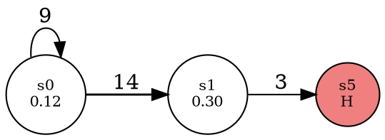

# DOT format: quick reference

DOT is Graphviz's plain-text graph description language.
Spec: <https://graphviz.org/doc/info/lang.html> · Attributes: <https://graphviz.org/doc/info/attrs.html>

## Skeleton

```dot
digraph G {          // directed graph; use `graph` for undirected
    // statements, separated by newlines or `;`
}
```

| Graph type | Edge operator |
|------------|---------------|
| `digraph`  | `->`          |
| `graph`    | `--`          |

`strict digraph G { ... }` merges duplicate edges into one.

## Statements

```dot
a;                          // node
a -> b;                     // edge (creates nodes if missing)
a -> b -> c;                // edge chain: a->b, b->c
a -> {b c};                 // a->b, a->c
a [label="Start"];          // node with attributes
a -> b [label="3"];         // edge with attributes
rankdir=LR;                 // graph attribute
node [shape=circle];        // default for all following nodes
edge [color=gray];          // default for all following edges
```

## IDs

An ID (node name, attribute value) is one of:

- an identifier: `[a-zA-Z_][a-zA-Z0-9_]*`
- a number: `42`, `-1.5`
- a quoted string: `"any text"` (escape `"` as `\"`)
- an HTML string: `<...>` (see below)

Use quotes for anything else, e.g. IDs with spaces or `(0,1)`.
Keywords (`node`, `edge`, `graph`, `digraph`, `subgraph`, `strict`) are case-insensitive and can't be bare IDs.

## Attributes

Syntax: `[key=value, key=value]` (`,` or `;` or whitespace as separator).

### Common node attributes

| Attribute   | Example                | Notes                                   |
|-------------|------------------------|-----------------------------------------|
| `label`     | `label="s3\n0.42"`     | `\n` centered line break, `\l` left, `\r` right |
| `shape`     | `shape=circle`         | `box`, `ellipse`, `circle`, `doublecircle`, `point`, `none` |
| `style`     | `style=filled`         | `filled`, `dashed`, `bold`, `invis`; combine: `"filled,bold"` |
| `fillcolor` | `fillcolor=lightblue`  | needs `style=filled`                    |
| `color`     | `color=red`            | outline color                           |
| `fontsize`  | `fontsize=10`          |                                         |
| `width`/`height` | `width=0.8`       | inches                                  |
| `pos`       | `pos="1,2!"`           | position (neato/fdp); `!` = fixed       |

### Common edge attributes

| Attribute   | Example             | Notes                              |
|-------------|---------------------|------------------------------------|
| `label`     | `label="12"`        | text on the edge                   |
| `penwidth`  | `penwidth=2.5`      | line thickness, good for counts    |
| `color`     | `color="#ff000080"` | names or `#RRGGBB[AA]`             |
| `style`     | `style=dashed`      |                                    |
| `arrowhead` | `arrowhead=none`    | `normal`, `vee`, `dot`, `none`     |
| `constraint`| `constraint=false`  | edge doesn't affect ranking (dot)  |

### Common graph attributes

| Attribute  | Example            | Notes                         |
|------------|--------------------|-------------------------------|
| `rankdir`  | `rankdir=LR`       | `TB` (default), `LR`, `BT`, `RL` |
| `splines`  | `splines=true`     | `true`, `false`, `ortho`, `curved` |
| `nodesep`  | `nodesep=0.5`      | inches                        |
| `ranksep`  | `ranksep=1.0`      | inches                        |
| `label`    | `label="Q-values"` | graph title                   |

Colors: names (`red`, `lightgray`, ...) or hex `"#RRGGBB"` (quoted).

## Subgraphs

```dot
subgraph cluster_row0 {     // name starting with `cluster` draws a box (dot)
    label="row 0";
    s0; s1; s2; s3;
}
{ rank=same; s0; s4; }      // force nodes onto the same rank (dot)
```

## HTML labels

Use `<...>` instead of `"..."` for rich labels:

```dot
s0 [shape=none, label=<<b>s0</b><br/><font point-size="9">0.42</font>>];
```

Tables are possible too (`<table>`, `<tr>`, `<td>`). Escape `&`, `<`, `>` as `&amp;`, `&lt;`, `&gt;`.

## Self-loops and multi-edges

```dot
s0 -> s0 [label="5"];   // self-loop
s0 -> s1 [label="L"];   // several edges between the same pair are allowed
s0 -> s1 [label="R"];   // (unless the graph is `strict`)
```

## Comments

`// line`, `/* block */`, and lines starting with `#`.

## Rendering

```sh
dot   -Tpng graph.dot -o graph.png    # hierarchical layout
dot   -Tsvg graph.dot -o graph.svg
neato -n -Tpng graph.dot -o graph.png # use given `pos` attributes (-n)
```

Layout engines: `dot` (layered), `neato`/`fdp` (force-directed), `circo` (circular), `twopi` (radial).
Install: `apt install graphviz`.

## Example


